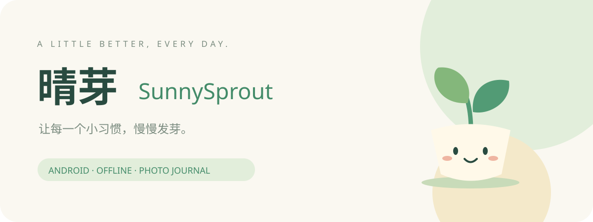

<p align="center"></p>

<p align="center"><b>每天一小步，把生活过成一座温柔的小花园。</b><br>A cozy, offline-first habit journal for Android.</p>

<p align="center">Android 8.0+ · 无需账号 · 无广告 · 照片日记 · 本地存储</p>

## 🌱 这是什么？

**晴芽**是一款明亮、可爱的 Android 习惯打卡应用。你可以从一个小习惯开始：每天读几页书、喝一杯水、散步十分钟。完成后点一下打卡，写一句话、留一张照片，把普通的日子变成可以回看的成长记录。

奶油白、薄荷绿、圆润的卡片，以及一只微笑的小芽，陪你慢慢生长。没有排行榜，也不用为了漏掉一天而责备自己。

## 📲 安装

[下载 晴芽 v1.0.0 APK](downloads/SunnySprout-v1.0.0.apk)（打开后选择下载原始文件）。支持 Android 8.0 及以上手机和平板，不需要 Google 服务。安装时允许下载文件所用应用安装 APK。

首次打开是真实空白数据。点「种下第一个习惯」开始，完成后点习惯右侧「＋」。已打卡显示「✓」，再次点击可以修改日记或撤销打卡。

## ✨ 已实现

| 功能 | 体验 |
| --- | --- |
| 自定义习惯 | 名称、小目标、12 个图标；支持多个习惯 |
| 每日打卡 | 每个习惯每个本地日期一条记录，重复点击编辑已有记录 |
| 照片日记 | 选择手机照片，压缩到最长边 1200 像素后本地保存 |
| 心情与文字 | 五种心情、1000 字日记，可以随时修改 |
| 月历与补记 | 月份切换、查看历史、过去日期补记，禁止未来日期打卡 |
| 连续天数 | 昨天完成而今天尚未完成时保留连续天数；支持跨月跨年 |
| 成长花园 | 每七次累计打卡提升一级，点亮累计成就纪念章 |
| 完整备份 | JSON 导出和导入，包含习惯、日记、心情及压缩照片 |
| 本地隐私 | 无联网权限，无账号，无广告，无分析 SDK |
| 屏幕适配 | 手机和平板布局，浅色界面，系统返回键关闭弹层 |

照片“上传”指从相册添加到应用本地；**没有上传到服务器**。备份是普通 JSON 文件，请放在可信位置。卸载或清除数据会删除本地记录，建议定期导出备份。

## 🛠️ 本地开发

原生 Java Activity + WebView 中的 HTML/CSS/JavaScript。原生日志存储使用 SharedPreferences；照片转换为 JPEG 数据随日记保存。系统文件选择器负责选图、备份文件导入和导出。没有第三方运行时依赖。

使用 Android Studio 打开项目（AGP 8.7.3、JDK 17、SDK 35），或直接使用 Android SDK 构建工具：

```bash
export ANDROID_HOME=/path/to/android-sdk
sdkmanager 'platforms;android-35' 'build-tools;35.0.0'
node scripts/test.cjs
bash scripts/build.sh
```

产物：`build/SunnySprout-v1.0.0.apk`。GitHub Actions 提供自动构建和 APK Artifact。

脚本使用开发签名，不是应用商店发布签名。保留本地 `build/development.keystore` 才能让后续构建覆盖安装；CI 每次生成新开发密钥，不能保证和已有 APK 的签名一致。切换签名前先备份，避免卸载导致数据丢失。正式发布应使用固定私有签名密钥。

## 🧪 验证与边界

已通过日期跨年、闰年、连续天数、重复打卡、备份往返及非法备份拒绝的自动检查。APK 已编译并验证签名。手机相册选择器、系统文件导出和不同厂商 WebView 的实际体验仍需真机验证。

当前没有通知提醒、云同步、账号系统、桌面小组件或计数型习惯；单张照片选择限制 30MB，导入备份限制 32MB。长期大量图片可能影响启动速度，暂不适合作为大容量照片库。

## 💡 设计参考

参考 [HabitKit](https://habitkit.app/) 的可视进度表达与 [Finch](https://help.finchcare.com/hc/en-us/articles/42149821015693-New-User-Guide) 的温柔陪伴理念。界面、角色矢量图与代码为本项目实现，未使用这些应用的源码或素材。

## English

SunnySprout turns everyday effort into a small garden. Create a habit, check in once per day, attach a photo and a mood, then revisit your progress in a calendar or photo journal. All data stays on your device. Complete JSON backups include compressed photos. No account, ads, network permission, or Google Play Services required.

**Built with:** Java, Android WebView, vanilla JavaScript, HTML and CSS. Android 8.0+. Development-signed APK included. Notifications and cloud sync are not implemented yet.

MIT License · Made by LR
